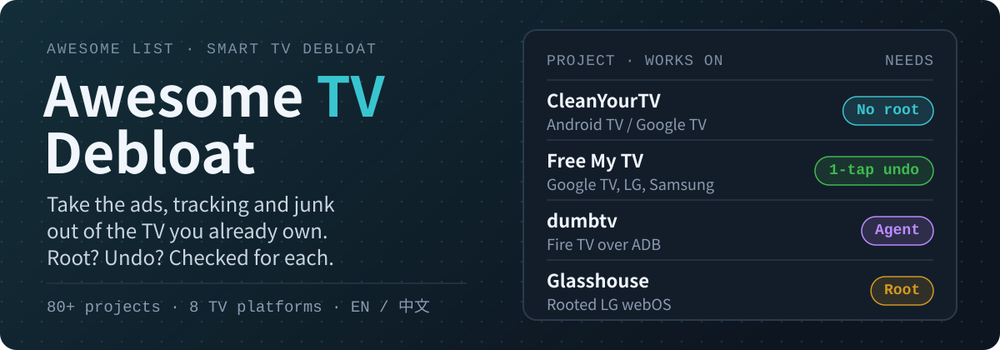

# Awesome TV Debloat: remove ads from your smart TV 

**English** · [简体中文](README.zh-CN.md)

  

  
  
  

**Take the ads, tracking and junk out of the smart TV you already own, and know before you start whether it needs root and how to undo it.**

> Unofficial. Not affiliated with Google, Amazon, LG, Samsung, Hisense, Xiaomi, TCL, Roku or any project listed. Every entry links to its own repository: read its README before you run anything on your TV.

**[Find your TV](#find-your-tv)** · **[No computer needed](#no-computer-needed)** · **[Before you start](#before-you-start)** · **[Using an AI agent](#using-an-ai-agent)** · **[Submit a project](https://github.com/AIshihzong/awesome-tv-debloat/issues/new?template=project.yml)**

> ⭐ **[Star this repo](https://github.com/AIshihzong/awesome-tv-debloat)** to keep it in your GitHub feed, or **Watch → Custom → Releases** to get one short digest a week of new TV projects.

In October 2026 [CleanYourTV](https://github.com/Gathin23/cleanyourtv) went from zero to over 50,000 stars in less than four weeks. It showed that a coding agent like Claude Code or Codex can clean up a TV over Wi-Fi in minutes, and hundreds of similar projects followed for every TV platform. This list sorts <!-- COUNT -->82<!-- /COUNT --> of them by the TV you have, and says for each one:

- **Root**: does it need root, LG or Samsung Developer Mode, or nothing at all?
- **Set up from**: do you need a computer, or is a phone or the TV remote enough?
- **Undo**: does the project document a way to put everything back?
- 🤖: it ships a prompt, skill or guide for a coding agent.

> Star counts and details were checked on <!-- DATE -->2026-11-10<!-- /DATE --> by reading each project's README. Projects in this space change weekly, so check the project's own page before relying on a detail.

## Contents

- [Find your TV](#find-your-tv)
- [Before you start](#before-you-start)
- [Android TV and Google TV: debloat tools](#android-tv-and-google-tv-debloat-tools)
- [Android TV and Google TV: ad-free home screens](#android-tv-and-google-tv-ad-free-home-screens)
- [Xiaomi, TCL and other China-market TVs](#xiaomi-tcl-and-other-china-market-tvs)
- [Amazon Fire TV](#amazon-fire-tv)
- [LG webOS: no root](#lg-webos-no-root)
- [LG webOS: rooted TVs](#lg-webos-rooted-tvs)
- [Samsung Tizen](#samsung-tizen)
- [Hisense VIDAA](#hisense-vidaa)
- [DNS and network blocklists](#dns-and-network-blocklists)
- [Ad-free YouTube on the TV](#ad-free-youtube-on-the-tv)
- [Tools and extras](#tools-and-extras)
- [Related lists](#related-lists)
- [Contributing](#contributing)

## Find your TV

| Your TV | Start with | No computer needed |
| --- | --- | --- |
| **Android TV / Google TV** (Sony, TCL, Philips, Hisense Google TV, Chromecast, Shield, onn) | [CleanYourTV](https://github.com/Gathin23/cleanyourtv) with a coding agent, or [CleanMyTV](https://github.com/wingedpanther/cleanmytv) for a Mac or Windows app | [Tellyscope](https://github.com/man15h/tellyscope), [TidyTV](https://github.com/jolan94/tidytv) |
| **Xiaomi, TCL, Skyworth and other China-market TVs** | [Aerial](https://github.com/pengchujin/aerial-tv), [tv-fresh](https://github.com/wangrongding/tv-fresh) for Xiaomi | [归藏电视](https://github.com/op7418/guizang-tv) |
| **Amazon Fire TV** | [dumbtv](https://github.com/humblemuzzu/dumbtv) | [Homestead](https://github.com/Sarg338/Homestead) |
| **LG webOS** | [Free My TV](https://github.com/simbasjungles/free-my-tv) (no root). Rooted: [Glasshouse](https://github.com/rorygallagher2024/glasshouse) | – |
| **Samsung Tizen** | [Apps2Samsung](https://github.com/Apps2Samsung/Apps2Samsung) to install [TizenTube](https://github.com/reisxd/TizenTube); [Free My TV](https://github.com/simbasjungles/free-my-tv) for a new home screen | Apps2Samsung also runs on Android and iPhone |
| **Hisense VIDAA** | [alvidaa](https://github.com/carteakey/alvidaa) | – |
| **Any TV** | A [DNS blocklist](#dns-and-network-blocklists) on your router, or [iSponsorBlockTV](https://github.com/dmunozv04/iSponsorBlockTV) for YouTube | – |

### No computer needed

[Tellyscope](https://github.com/man15h/tellyscope), [TidyTV](https://github.com/jolan94/tidytv) and the [Clean Your TV app](https://github.com/udhaykumarbala/cleanyourtv-app) do the whole Android TV clean-up from an Android phone. [Homestead](https://github.com/Sarg338/Homestead), [Plume](https://github.com/aradhyas8/Plume_Launcher), [tvOS Launcher](https://github.com/techgenius1/tvOS-Launcher) and [Aura](https://github.com/cookedzera/aura-tv) install on the TV itself with the Downloader app.

## Before you start

1. **Disable, don't uninstall.** `adb shell pm disable-user --user 0 <package>` switches an app off, and `adb shell pm enable <package>` brings it back. Every well-behaved project here works this way.
2. **Don't disable the stock launcher** unless the project says how to get it back. On many TVs this breaks setup screens or input switching, or leaves the TV with no home screen until a factory reset.
3. **Keep a record first.** Save the output of `adb shell pm list packages -d` (what is already disabled) before you change anything.
4. **Firmware updates turn things back on.** Expect to re-run the clean-up after an update. Some tools here detect this for you.
5. **Turn off network debugging when you're done.** Wi-Fi ADB and Developer Mode let any device on your network control the TV.
6. **Root is a security exploit.** It can void your warranty, and an update can undo it or brick the TV. Use the no-root options first.
7. **Get APKs from the project's own GitHub releases**, not from mirror sites that reuse the project's name.

### Using an AI agent

Projects marked 🤖 ship a prompt or skill you hand to Claude Code, Codex, Cursor or Gemini CLI, which then runs the `adb` commands on your computer for you. A good prompt makes the agent show what it found, ask before each change, never uninstall, and keep a restore list. Read the prompt before you paste it. Chat-only assistants (a web chat or a phone app) can tell you the steps but cannot run them. Some projects note that agents may refuse the root steps; that is expected.

## Android TV and Google TV: debloat tools

<!-- BEGIN android-debloat -->
Sony, TCL, Hisense, Philips, Chromecast with Google TV, NVIDIA Shield, onn and other Android-based TVs. Almost all of these switch apps off over Wi-Fi ADB with `pm disable-user`, which a single `pm enable` reverses.

| Project | ★ | Root | Set up from | Undo | What it does |
| --- | ---: | --- | --- | :---: | --- |
| [CleanYourTV](https://github.com/Gathin23/cleanyourtv) 🤖 | 55.8k | No | 💻 Computer | ✅ | The one that started the wave. A coding agent finds your TV's bloat over Wi-Fi, asks before each change, and installs an Apple TV-style home screen. One-line restore. |
| [TV Detox](https://github.com/Ansub/tv-detox) 🤖 | 2,305 | No | 💻 Computer | ✅ | Makes an old, slow Android TV fast again: Claude Code or Codex does the work, you press OK on the remote. Covered by Mashable and t3n. |
| [Clean Your TV app](https://github.com/udhaykumarbala/cleanyourtv-app) | 1,915 | No | 📱 Phone | ✅ | CleanYourTV as an Android phone app: no laptop and no coding agent. Shows the plan before changing anything. |
| [Tellyscope](https://github.com/man15h/tellyscope) | 1,823 | No | 📱 Phone | ✅ | 3 MB phone app: debloat, install APKs, move files. Every change goes into a history with Undo, plus a full Reset TV. Also Fire TV and Shield. |
| [Android TV Toolkit](https://github.com/seun-novodev/android-tv-debloat-toolkit) | 813 | No | 💻 Computer | ⚠️ | Desktop GUI for TCL and Google TV debloat and APK installs. The author says it is no longer actively maintained. |
| [tv-home](https://github.com/mihirgupta0900/tv-home) 🤖 | 758 | No | 💻 Computer | ✅ | One Claude Code prompt, or scripts by hand. On a 2 GB TCL Google TV it cut home-screen memory from 192 MB to 83 MB. |
| [CleanMyTV](https://github.com/wingedpanther/cleanmytv) | 480 | No | 💻 Computer | ✅ | Free Mac and Windows app built on CleanYourTV's per-TV lists. No Python or `adb` to install, with a user guide and a known-devices table. |
| [tv-vibehack](https://github.com/ToomRamcharan/tv-vibehack) | 334 | No | 💻 Computer | ⚠️ | Built for aging parents: a direct-boot launcher, and the sponsored Netflix or Prime buttons on the remote remapped to HDMI. |
| [Kit TV Android](https://github.com/xMazaki/unbloat-android-tv) | 302 | No | 💻 Computer | ✅ | Double-click app for Windows, Mac and Linux, in French and English. Has a Restore everything option. |
| [Android TV Makeover](https://github.com/kulwantnagi/android-tv-makeover) 🤖 | 183 | No | 💻 Computer | ✅ | Debloat, an Apple TV-style launcher and a phone remote served by the TV itself. `PROMPT.md` walks a coding agent through it. |
| [Glass TV](https://github.com/cocombee/glass-tv) 🤖 | 159 | No | 💻 Computer | ✅ | Debloat plus a frosted-glass home screen that clears app caches every 15 days, so the TV stays fast. |
| [tv (cobanov)](https://github.com/cobanov/tv) 🤖 | 115 | No | 💻 Computer | ✅ | A one-page guide and an agent prompt in ten languages. The prompt forbids `pm uninstall`, root and custom ROMs outright. |
| [TidyTV](https://github.com/jolan94/tidytv) | 111 | No | 📱 Phone | ✅ | Phone app that saves a backup on both TV and phone before switching anything off. "No computer. No AI." |
| [TV Remote](https://github.com/HoangTran0410/tv-remote) | 101 | No | 📱 Phone · 💻 Computer | ✅ | Remote from phone, computer or browser, with an Optimize TV button that Undo fully reverses. Also LG, Samsung, Roku and VIDAA. |
| [Claude TV](https://github.com/vishalsingh2972/Claude-TV) 🤖 | 85 | No | 💻 Computer | ✅ | A native launcher with no Internet permission, plus model-specific debloat lists and restore scripts for Bash and PowerShell. Not affiliated with Anthropic. |
| [ChistyTV](https://github.com/by-sonic/chistytv) 🤖 | 84 | No | 💻 Computer · 📱 Phone | ✅ | Russian. One PowerShell line or an Android APK, for Yandex TV, Salute TV, Xiaomi, TCL, Haier and Google TV. |
<!-- END android-debloat -->

## Android TV and Google TV: ad-free home screens

<!-- BEGIN android-launchers -->
Launchers only, without a debloat step. On many Google TVs the stock launcher cannot be fully replaced; these use a Home-button service instead. Do not disable the stock launcher unless the project tells you how to get it back.

| Project | ★ | Root | Set up from | Undo | What it does |
| --- | ---: | --- | --- | :---: | --- |
| [Tigris](https://github.com/lesnolie/Tigris) 🤖 | 644 | No | 📺 TV only · 💻 Computer | ✅ | tvOS 26-style dock, Top Shelf and Control Center. Chinese and English, with a webOS preview build. |
| [OmarchyTV](https://github.com/piermark/omarchytv) 🤖 | 514 | No | 💻 Computer | ⚠️ | Omarchy-styled launcher for Android TV, LG and Samsung, with a phone-as-gamepad arcade. Beta. |
| [TV Launcher](https://github.com/nielsvanvelzen/tv-launcher) | 499 | No | 📺 TV only | – | Early-stage launcher for big screens, from a Jellyfin Android TV developer. |
| [couch-tv](https://github.com/Seagey/couch-tv) 🤖 | 497 | No | 💻 Computer | ✅ | Home screen and phone remote for Google TV, Samsung and LG, with an optional Claude assistant. Read its 8 November note on restart loops. |
| [LTvLauncher](https://github.com/leanbitlab-org/LtvLauncher) | 469 | No | 📺 TV only | – | FLauncher fork for Android TV, Google TV and Fire TV: Continue Watching, input switching, OLED screensaver. |
| [tvOS Launcher](https://github.com/techgenius1/tvOS-Launcher) | 398 | No | 📺 TV only | ✅ | About 30 MB of RAM and no background CPU. Runs CleanYourTV debloat profiles on the TV itself, no PC needed. |
| [Plume](https://github.com/aradhyas8/Plume_Launcher) | 360 | No | 📺 TV only | ✅ | 0.4 MB, glass design, Continue Watching, 250+ aerial screensavers. Takes the Home button on Google TV where the launcher can't be replaced. |
| [Luma](https://github.com/0xProbabillity/luma-tv) | 224 | No | 💻 Computer | ✅ | Calm, tvOS-inspired home over living wallpapers. `./luma.sh restore` undoes everything the installer changed. |
| [Couchy Launcher](https://github.com/conreo/couchy-launcher) | 156 | No | 📺 TV only | ✅ | One-screen launcher that makes no network requests out of the box. English and Chinese. |
| [Talkies](https://github.com/rajupp/talkies) 🤖 | 141 | No | 📺 TV only · 💻 Computer | ✅ | One screen: your apps, what is trending locally, live cricket and football scores. Install with no computer, a computer, or an AI assistant. |
| [Matinee](https://github.com/Jarvis322/matinee) | 121 | No | 📺 TV only | – | Only the apps you installed, in your order, with your last-played show. Row and grid layouts. |
| [GlassOS](https://github.com/AbhishekKaisar/glassos-tv) 🤖 | 118 | No | 💻 Computer | ✅ | Glassy tvOS-style home with a trending Top Shelf and Control Center. Also on Fire TV. |
| [Glassio](https://github.com/mohammadmrh12/glassio) | 100 | No | 📺 TV only | – | Apple TV-style home fed by Nuvio and Stremio catalogs, with Trakt and Simkl Continue Watching. |
| [Aura](https://github.com/cookedzera/aura-tv) | 84 | No | 📺 TV only | ✅ | Installs from the TV with a Downloader code. 60 fps on a 1.5 GB TV. |
| [Material TV Launcher](https://github.com/0xRampey/material-tv-launcher) | 76 | No | 📺 TV only | – | Material 3 launcher that orders apps by use. Optional Gemini voice with your own key. |
<!-- END android-launchers -->

## Xiaomi, TCL and other China-market TVs

<!-- BEGIN china -->
China-market firmware (PatchWall, TCL, Skyworth/Coocaa, Hisense VIDDA) ships more ads and boot-screen promotions, and often lacks Google services. These projects are written for it, mostly in Chinese.

| Project | ★ | Root | Set up from | Undo | What it does |
| --- | ---: | --- | --- | :---: | --- |
| [Aerial](https://github.com/pengchujin/aerial-tv) 🤖 | 11.1k | No | 💻 Computer | ✅ | The biggest Chinese one. tvOS-style launcher for Xiaomi, TCL, Skyworth and Sony sets, boxes and projectors; survives standby cleanup. Works with Chinese agents (Doubao, Qwen, Trae) too. |
| [tv-fresh](https://github.com/wangrongding/tv-fresh) 🤖 | 768 | No | 💻 Computer | ✅ | Xiaomi MIUI TV guide and agent skill: remove ads and preinstalls, switch to Projectivy. Uses `pm uninstall --user 0`, reversible with `install-existing`. |
| [tvhome-zh](https://github.com/mclhm8182/tvhome-zh) | 320 | No | 💻 Computer | ✅ | Ready-to-install Chinese build of the CleanYourTV launcher. No build step. |
| [归藏电视](https://github.com/op7418/guizang-tv) | 299 | No | 📺 TV only | ✅ | Clean Xiaomi TV launcher with large text and direct HDMI shortcuts to consoles and Apple TV. |
| [Quiet TV](https://github.com/BeatsAD/quiet-tv) | 256 | No | 📺 TV only · 💻 Computer | ✅ | Lightweight launcher and app manager for China-market TVs, with reversible slimming and a per-model test log. |
| [miTVhosts](https://github.com/liamliu108/miTVhosts) | 158 | No | 🌐 Router / DNS | ✅ | Hosts file for a Xiaomi router that blocks Mi TV ads and updates. Old (last change 2024) but still referenced. |
| [GlassTV 玻璃桌面](https://github.com/jichun29/glasstv) 🤖 | 97 | No | 💻 Computer | ✅ | Glass launcher with flip-clock screensaver. Disables no system apps at all. |
| [Android TV 调优工具箱](https://github.com/VictorTran1023/android-tv-toolkit) 🤖 | 89 | No | 💻 Computer | ✅ | Brand-by-brand ADB playbook for TCL, Xiaomi, Hisense, Skyworth, Changhong, Konka, XGIMI and Dangbei. Snapshot, one change at a time, `restore-all`. |
<!-- END china -->

## Amazon Fire TV

<!-- BEGIN fire -->
Fire OS protects Amazon's launcher as a system app, so without root you cannot disable it. These projects redirect the Home button instead, and switch off Amazon's ad and telemetry services.

| Project | ★ | Root | Set up from | Undo | What it does |
| --- | ---: | --- | --- | :---: | --- |
| [dumbtv](https://github.com/humblemuzzu/dumbtv) 🤖 | 2,023 | No | 💻 Computer | ✅ | Takes ads, tracking and clutter out of a Fire TV over ADB and keeps your apps and HDMI inputs. One command undoes it. |
| [Home on Fire](https://github.com/toolicious/home-on-fire) | 102 | No | 📺 TV only | – | Redirects the Home button to the launcher you choose, and opens it at boot. |
| [Firestick Cleanup](https://github.com/niftiest/Firestick-Cleaner-And-Launcher-Replacer) | 77 | No | 💻 Computer | ✅ | Installs Projectivy Launcher and disables Amazon bloat in one automated run. |
| [Homestead](https://github.com/Sarg338/Homestead) | 66 | No | 📺 TV only | ✅ | Replacement home and Home button for Fire TV. An on-device ADB tunnel means no computer is needed. |
| [FireFrame](https://github.com/dyascj/FireFrame) | 65 | No | 💻 Computer | ✅ | Your apps, a photo and the time, plus one undoable script that turns off Amazon ads, tracking, Alexa and Prime Video. |
<!-- END fire -->

## LG webOS: no root

<!-- BEGIN webos -->
These install through LG's official Developer Mode. The stock home screen stays; you open the new one as an app or with a Home-button helper. Developer Mode sessions expire and need renewing.

| Project | ★ | Root | Set up from | Undo | What it does |
| --- | ---: | --- | --- | :---: | --- |
| [Free My TV](https://github.com/simbasjungles/free-my-tv) | 6,227 | Dev Mode | 💻 Computer | ✅ | Fast, ad-free home for Google TV, LG and Samsung, built with Claude Code. Nothing uninstalled; one button brings the factory home back. |
| [webos-vibehack](https://github.com/OmkarK97/webos-vibehack) | 376 | Dev Mode | 💻 Computer | ✅ | webOS port of the Apple TV-style launcher, tested on an LG OLED C6 (webOS 26). |
| [Hearth](https://github.com/rudra-avatar/Hearth) | 355 | Dev Mode | 💻 Computer | ✅ | Calm home for webOS 3 to 26. Works as a normal app; on a rooted TV it can also be the boot screen and the Home button. |
| [Clean Your TV for webOS](https://github.com/Razdva122/clean-your-tv-lg-webos) | 338 | Dev Mode | 💻 Computer | ✅ | Personal home with your apps and a dock, plus an on-TV Home helper. It says plainly that it does not remove ads from LG's other screens. |
| [Free My TV for webOS](https://github.com/danielthejoker18/FreeMyTvWebOS) | 319 | Dev Mode | 💻 Computer | ✅ | 60 fps frosted-glass shelf with live weather on unrooted LG TVs. English and Portuguese. |
| [Mi pantalla](https://github.com/frxnnk/webos-liquid-glass-launcher) 🤖 | 62 | Dev Mode | 💻 Computer | ⚠️ | Spanish. Liquid-glass launcher for webOS 5 without root, with a reproducible tutorial and an agent bridge. |
| [TheBoringTV](https://github.com/theboringhumane/theboringtv-lgwebos) | 60 | Dev Mode | 💻 Computer | ✅ | Google TV-style home as a plain HTML/JS app, no build step. Becomes the real home on rooted TVs. |
<!-- END webos -->

## LG webOS: rooted TVs

<!-- BEGIN webos-root -->
Root lets a launcher really take over Home and lets you block LG's ad and ACR (what-you-watch) services. Most current LG firmware is patched against the public exploits, so check your firmware version first.

| Project | ★ | Root | Set up from | Undo | What it does |
| --- | ---: | --- | --- | :---: | --- |
| [RootMyTV](https://github.com/RootMyTV/RootMyTV.github.io) | 2,525 | **Yes** | 📺 TV only | – | The classic browser-based root. Patched by LG; unlikely to work on firmware since mid-2022. |
| [Glasshouse](https://github.com/rorygallagher2024/glasshouse) | 2,039 | **Yes** | 💻 Computer | ⚠️ | Dashboard, privacy controls, debloat, ad and telemetry blocker and Home Assistant bridge, running on the TV itself. |
| [Homebrew Channel](https://github.com/webosbrew/webos-homebrew-channel) | 1,731 | **Yes** | 💻 Computer | – | The unofficial webOS app store and root tooling that most rooted-TV projects below build on. |
| [dejavuln-autoroot](https://github.com/throwaway96/dejavuln-autoroot) | 851 | **Yes** | 💻 Computer | – | Roots webOS 3.5+ TVs. 2024 models and recent firmware for most webOS 5+ TVs are patched. |
| [faultmanager-autoroot](https://github.com/throwaway96/faultmanager-autoroot) | 515 | **Yes** | 💻 Computer | – | Roots webOS 4.0+ TVs and installs the Homebrew Channel. Check the supported-firmware notes first. |
| [CleanYourTV for webOS](https://github.com/lasharor/cleanyourtv-WebOS) 🤖 | 480 | **Yes** | 💻 Computer | ✅ | Takes over Home with a RAM-only mount, so a reboot without it restores LG's own home. Optional ad and telemetry debloat. |
| [own-your-glass](https://github.com/JulioFerrero/own-your-glass) | 453 | **Yes** | 💻 Computer | ✅ | Hardening: disables the microphones and the remote's voice pipeline, plugs the screen-capture leak, blocks ad, telemetry and ACR endpoints. |
| [Luma for webOS](https://github.com/ecklf/lg-luma) | 364 | **Yes** | 💻 Computer | ✅ | Native Apple TV-inspired launcher for rooted LG TVs. |
| [Lumen](https://github.com/ammar027/lumen-webos) | 117 | **Yes** | 💻 Computer | ✅ | tvOS-style home tuned for weak TV GPUs, tested on a 1.5 GB webOS 22 set. |
| [Lightkeeper](https://github.com/chiotas/lightkeeper) | 101 | **Yes** | 💻 Computer | ✅ | Calm home for older webOS, made to sit beside Glasshouse. |
<!-- END webos-root -->

## Samsung Tizen

<!-- BEGIN tizen -->
Most launchers install through Tizen Developer Mode. Taking over the Home button means rewriting undocumented settings, so read each project's undo section before you start.

| Project | ★ | Root | Set up from | Undo | What it does |
| --- | ---: | --- | --- | :---: | --- |
| [Apps2Samsung](https://github.com/Apps2Samsung/Apps2Samsung) | 2,587 | No | 💻 Computer · 📱 Phone | ✅ | One-click installer for Tizen TVs, projectors and monitors (Jellyfin, TizenTube and more), from Windows, Mac, Linux, Android or iPhone. No Tizen Studio. |
| [Samsung TV root](https://github.com/chris-ritsen/samsung-tv-root) 🤖 | 556 | **Yes** | 💻 Computer | ⚠️ | Working root exploits for a QN90B and a QN90F, built with Codex in a day and in three hours. |
| [Quiet Tizen](https://github.com/jss8649/quiet-tizen) 🤖 | 551 | **Yes** | 💻 Computer | ✅ | Agent-readable guide from one Samsung U8000F (Tizen 9): quiet launcher, cleanup planner with generated restore SQL. |
| [Vetro](https://github.com/andrearicci93/vetro) 🤖 | 329 | **Yes** | 💻 Computer · 📱 Phone | ✅ | Launcher, debloater and remote remapper with a dashboard served by the TV. Needs root; about 24% more free RAM on a Q80A. |
| [TizenBrew Installer](https://github.com/reisxd/TizenBrewInstaller) | 281 | No | 💻 Computer | – | Installs TizenBrew and other Tizen apps, with re-signing for Tizen 7+. |
| [Arn0 Launcher](https://github.com/NelsonEU/arn0-tv) 🤖 | 267 | Dev Mode | 💻 Computer | ✅ | Clock, your apps and your consoles, nothing else. Takes Home by rewriting undocumented settings, with a saved baseline to undo. |
| [Glass Home](https://github.com/victaphu/glass-home-samsung-tv) | 247 | Dev Mode | 💻 Computer | ✅ | Apple TV-style home with rotating photos, plus a password-protected site on the TV for adding photos from your phone. |
| [AeroTizen](https://github.com/helalaou/AeroTizen) | 102 | Dev Mode | 💻 Computer | ✅ | Favourite apps and HDMI inputs in one place; a CLI installs it from your computer. |
| [TV Home](https://github.com/berteotti/custom-tv) | 94 | Dev Mode | 💻 Computer | ✅ | Weather-matched landscapes behind your apps, with a level-by-level table of what each step takes and how to undo it. |
<!-- END tizen -->

## Hisense VIDAA

<!-- BEGIN vidaa -->
VIDAA is Hisense's own OS (not the Android-based VIDDA sold in China).

| Project | ★ | Root | Set up from | Undo | What it does |
| --- | ---: | --- | --- | :---: | --- |
| [Sidee](https://github.com/Empi9245/Sidee) | 80 | No | 💻 Computer | ⚠️ | Browser dashboard to add web-app tiles to VIDAA TVs. Starts with a double-click on Windows. |
| [alvidaa](https://github.com/carteakey/alvidaa) 🤖 | 53 | No | 💻 Computer | ✅ | Self-installing VIDAA launcher (no root, reversible), plus the first public root path for 2024+ VIDAA firmware. |
<!-- END vidaa -->

## DNS and network blocklists

<!-- BEGIN dns -->
Use with Pi-hole, AdGuard Home or your router. Works on any TV, with no changes on the TV itself; it can also break features, so start with the safe tier.

| Project | ★ | Root | Set up from | Undo | What it does |
| --- | ---: | --- | --- | :---: | --- |
| [LG TV Blocklist](https://github.com/furkan-bayrak/lg-tv-blocklist) | 438 | No | 🌐 Router / DNS | ✅ | Evidence-annotated DNS list for LG telemetry, ads and phone-home traffic, in safe and strict tiers. CC BY 4.0. |
| [LG TV Ad Block](https://github.com/TheShawnMiranda/LG-TV-Ad-Block) | 110 | No | 🌐 Router / DNS | ✅ | Raw ad and recommended-content blocklist for webOS, tested on an LG C2 in North America. |
<!-- END dns -->

## Ad-free YouTube on the TV

<!-- BEGIN youtube -->
Third-party YouTube clients and SponsorBlock add-ons. Signing in with your Google account is optional in most of them.

| Project | ★ | Root | Set up from | Undo | What it does |
| --- | ---: | --- | --- | :---: | --- |
| [SmartTube](https://github.com/yuliskov/SmartTube) | 36.2k | No | 📺 TV only | – | The best-known ad-free YouTube for Android TV and Fire TV. Read the maintainer's security notice at the top of its README first: some past builds may have been affected and the signing key was replaced. |
| [iSponsorBlockTV](https://github.com/dmunozv04/iSponsorBlockTV) | 7,039 | No | 💻 Computer | – | Self-hosted: connects to the official YouTube app on your TV and skips sponsor segments, and can mute ads and press Skip Ad for you. Nothing installed on the TV. |
| [TizenTube Cobalt](https://github.com/reisxd/TizenTubeCobalt) | 3,533 | No | 📺 TV only | – | Ad blocking and SponsorBlock for Android TV, on Google's Cobalt runtime. |
| [TizenTube](https://github.com/reisxd/TizenTube) | 2,493 | No | 💻 Computer | – | Removes ads and adds SponsorBlock on Samsung Tizen TVs, via TizenBrew or standalone. |
| [Playlet](https://github.com/iBicha/playlet) | 803 | No | 📺 TV only | – | Unofficial, privacy-focused YouTube client for Roku. |
| [YouTube webOS Cobalt AdFree](https://github.com/RF1705/youtube-webos-cobalt-adfree) | 264 | Dev Mode | 💻 Computer | – | Cobalt-based YouTube for LG webOS with ad blocking and SponsorBlock. |
<!-- END youtube -->

## Tools and extras

<!-- BEGIN tools -->
| Project | ★ | Root | Set up from | Undo | What it does |
| --- | ---: | --- | --- | :---: | --- |
| [Aerial Views](https://github.com/theothernt/AerialViews) | 1,154 | No | 📺 TV only | – | Apple TV-style aerial screensaver for Android TV, Google TV, Shield and Fire TV. |
| [sky adb](https://github.com/sky22333/skyadb) | 760 | No | 📱 Phone | – | Android phone app for Wi-Fi ADB and wireless debugging, with LAN discovery. Chinese. |
<!-- END tools -->

## Related lists

<!-- BEGIN related -->
- [Awesome Android TV FOSS Apps](https://github.com/Generator/Awesome-Android-TV-FOSS-Apps) (1,668 ★): Open-source apps for Android TV, with remote-support and root markers.
- [Awesome Smart TV](https://github.com/vitalets/awesome-smart-tv) (1,467 ★): For developers building Smart TV apps.
- [Awesome webOS](https://github.com/tolgakurtuluss/awesome-webos) (241 ★): Apps, launchers, homebrew repos and rooting tools for webOS, with a safety page.
<!-- END related -->

## Contributing

Know a project that is missing, or a detail that is wrong? [Open an issue](https://github.com/AIshihzong/awesome-tv-debloat/issues/new?template=project.yml) or send a pull request. See [CONTRIBUTING.md](CONTRIBUTING.md).

**What gets in:** open-source projects that remove ads, bloat or tracking from a TV, or replace its home screen, with a README that says how to undo the change. Not accepted: IPTV playlists, paid-channel access, piracy add-ons, or APK mirrors.

**How entries are checked:** the Root, Set up from and Undo columns come from each project's own README, not from its description. The tables are generated from [`data/projects.json`](data/projects.json) by [`scripts/build.py`](scripts/build.py), and star counts refresh every week.

If your project is listed, you are welcome to add a badge: ``

## License

[CC0 1.0](LICENSE). Project names and trademarks belong to their owners.

---

From the maintainer of [Awesome REA](https://github.com/AIshihzong/awesome-reverse-engineer-anything), a fact-checked list of what AI agents reverse-engineered and rebuilt.
