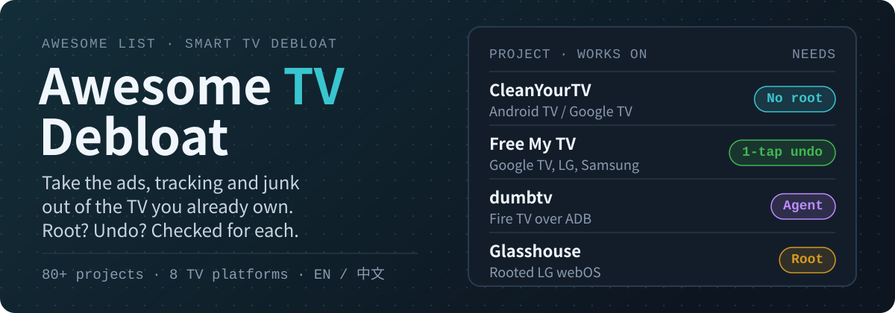

# Awesome TV Debloat：智能电视去广告清单 

[English](README.md) · **简体中文**

  

  
  
  

**把广告、追踪和预装垃圾从你已经买下的电视里拿掉，动手前先知道要不要 root、能不能还原。**

> 非官方清单，与谷歌、亚马逊、LG、三星、海信、小米、TCL、Roku 以及收录的任何项目都没有关系。每一条都链接到项目自己的仓库，在电视上运行任何东西之前，先读它的 README。

**[按电视查](#按电视查)** · **[不用电脑](#不用电脑)** · **[动手前必读](#动手前必读)** · **[交给 AI Agent 做](#交给-ai-agent-做)** · **[推荐项目](https://github.com/AIshihzong/awesome-tv-debloat/issues/new?template=project.yml)**

> ⭐ **[Star 本仓库](https://github.com/AIshihzong/awesome-tv-debloat)**，它会出现在你的 GitHub 动态里；或者点 **Watch → Custom → Releases**，每周收到一份新项目周报。

2026 年 10 月，[CleanYourTV](https://github.com/Gathin23/cleanyourtv) 不到四周就从零涨到 5 万多星。它证明了 Claude Code、Codex 这样的编程 Agent 可以在几分钟内通过 Wi-Fi 把一台电视收拾干净，随后各个电视平台都冒出了几百个类似项目。这份清单按你家的电视整理了其中 <!-- COUNT -->82<!-- /COUNT --> 个，每一条都写清楚：

- **要 root 吗**：需要 root，需要 LG 或三星的开发者模式，还是什么都不用？
- **在哪操作**：必须用电脑，还是手机或遥控器就够了？
- **可还原**：项目有没有写明怎么恢复原样？
- 🤖：附带给编程 Agent 用的提示词、技能或指南。

> 星数和细节核对于 <!-- DATE -->2026-11-10<!-- /DATE -->，逐个读过项目的 README。这个领域每周都在变，依赖某个细节之前，请到项目页面再确认一次。

## 目录

- [按电视查](#按电视查)
- [动手前必读](#动手前必读)
- [Android TV 和 Google TV：去广告、精简工具](#android-tv-和-google-tv去广告精简工具)
- [Android TV 和 Google TV：无广告桌面](#android-tv-和-google-tv无广告桌面)
- [小米、TCL 等国产电视](#小米tcl-等国产电视)
- [Amazon Fire TV](#amazon-fire-tv)
- [LG webOS：不需要 root](#lg-webos不需要-root)
- [LG webOS：已 root 的电视](#lg-webos已-root-的电视)
- [三星 Tizen](#三星-tizen)
- [海信 VIDAA](#海信-vidaa)
- [DNS 和网络屏蔽列表](#dns-和网络屏蔽列表)
- [电视上看 YouTube 不看广告](#电视上看-youtube-不看广告)
- [工具和其他](#工具和其他)
- [相关清单](#相关清单)
- [参与贡献](#参与贡献)

## 按电视查

| 你的电视 | 先试这个 | 不用电脑 |
| --- | --- | --- |
| **小米、TCL、创维等国产电视** | [Aerial](https://github.com/pengchujin/aerial-tv)；小米电视看 [tv-fresh](https://github.com/wangrongding/tv-fresh) | [归藏电视](https://github.com/op7418/guizang-tv) |
| **Android TV / Google TV**（索尼、TCL 海外版、飞利浦、海信 Google TV、Chromecast、Shield、onn） | [CleanYourTV](https://github.com/Gathin23/cleanyourtv) 配合编程 Agent，或者用 Mac、Windows 应用 [CleanMyTV](https://github.com/wingedpanther/cleanmytv) | [Tellyscope](https://github.com/man15h/tellyscope)、[TidyTV](https://github.com/jolan94/tidytv) |
| **Amazon Fire TV** | [dumbtv](https://github.com/humblemuzzu/dumbtv) | [Homestead](https://github.com/Sarg338/Homestead) |
| **LG webOS** | [Free My TV](https://github.com/simbasjungles/free-my-tv)（不用 root）；已 root：[Glasshouse](https://github.com/rorygallagher2024/glasshouse) | – |
| **三星 Tizen** | 用 [Apps2Samsung](https://github.com/Apps2Samsung/Apps2Samsung) 装 [TizenTube](https://github.com/reisxd/TizenTube)；换桌面用 [Free My TV](https://github.com/simbasjungles/free-my-tv) | Apps2Samsung 也有安卓和 iPhone 版 |
| **海信 VIDAA** | [alvidaa](https://github.com/carteakey/alvidaa) | – |
| **任何电视** | 在路由器上用 [DNS 屏蔽列表](#dns-和网络屏蔽列表)；YouTube 用 [iSponsorBlockTV](https://github.com/dmunozv04/iSponsorBlockTV) | – |

### 不用电脑

[Tellyscope](https://github.com/man15h/tellyscope)、[TidyTV](https://github.com/jolan94/tidytv) 和 [Clean Your TV app](https://github.com/udhaykumarbala/cleanyourtv-app) 用一部安卓手机就能完成 Android TV 的整套清理。[Homestead](https://github.com/Sarg338/Homestead)、[Plume](https://github.com/aradhyas8/Plume_Launcher)、[tvOS Launcher](https://github.com/techgenius1/tvOS-Launcher) 和 [Aura](https://github.com/cookedzera/aura-tv) 可以在电视上用 Downloader 应用直接安装。

## 动手前必读

1. **停用，不要卸载。** `adb shell pm disable-user --user 0 <包名>` 停用应用，`adb shell pm enable <包名>` 恢复。这里靠谱的项目都是这么做的。
2. **不要停用原厂桌面**，除非项目写明了怎么恢复。很多电视停用后会卡在开机向导、切不了信号源，甚至没有桌面，只能恢复出厂。
3. **先留记录。** 动手前保存 `adb shell pm list packages -d` 的输出（已经被停用的应用）。
4. **固件更新会把应用重新打开。** 更新后要再清理一次，有些工具会自动发现。
5. **用完关掉网络调试。** Wi-Fi ADB 和开发者模式开着时，同一网络里的任何设备都能控制电视。
6. **root 是在利用安全漏洞。** 可能失去保修，系统更新可能让它失效，甚至让电视变砖。先试不用 root 的办法。
7. **APK 只从项目自己的 GitHub Releases 下载**，不要用借项目名字的镜像站。

### 交给 AI Agent 做

标了 🤖 的项目附带提示词或技能，交给 Claude Code、Codex、Cursor、Gemini CLI，或者能在电脑上执行命令的国产 Agent（如 Trae、豆包电脑版），它们会替你在电脑上执行 `adb` 命令。好的提示词会让 Agent 先展示发现了什么，每一步改动都先问你，绝不卸载，并保留还原清单。粘贴前先读一遍提示词。网页版或手机上的聊天助手只能告诉你步骤，不会替你执行。有些项目提到 Agent 可能拒绝执行 root 步骤，这是正常的。

## Android TV 和 Google TV：去广告、精简工具

<!-- BEGIN android-debloat -->
索尼、TCL、海信、飞利浦、Chromecast with Google TV、NVIDIA Shield、onn 等基于 Android 的电视。几乎都是通过 Wi-Fi ADB 用 `pm disable-user` 停用应用，一条 `pm enable` 就能恢复。

| 项目 | ★ | 需 root | 在哪操作 | 可还原 | 说明 |
| --- | ---: | --- | --- | :---: | --- |
| [CleanYourTV](https://github.com/Gathin23/cleanyourtv) 🤖 | 55.8k | 不用 | 💻 电脑 | ✅ | 这一波的起点。让编程 Agent 通过 Wi-Fi 找出电视上的预装垃圾，每一步都先问你，再装一个 Apple TV 风格的桌面。一行命令就能还原。 |
| [TV Detox](https://github.com/Ansub/tv-detox) 🤖 | 2,305 | 不用 | 💻 电脑 | ✅ | 让老旧卡顿的 Android TV 重新变快：Claude Code 或 Codex 干活，你只需按遥控器的确认键。Mashable、t3n 报道过。 |
| [Clean Your TV app](https://github.com/udhaykumarbala/cleanyourtv-app) | 1,915 | 不用 | 📱 手机 | ✅ | CleanYourTV 的安卓手机版，不用电脑也不用 Agent。动手前会先列出计划。 |
| [Tellyscope](https://github.com/man15h/tellyscope) | 1,823 | 不用 | 📱 手机 | ✅ | 3 MB 的手机应用：精简、装 APK、传文件。每次改动都记进历史，可以逐条撤销，也能一键恢复出厂状态。支持 Fire TV 和 Shield。 |
| [Android TV Toolkit](https://github.com/seun-novodev/android-tv-debloat-toolkit) | 813 | 不用 | 💻 电脑 | ⚠️ | 桌面图形界面，针对 TCL 和 Google TV 精简和装 APK。作者说明已不再积极维护。 |
| [tv-home](https://github.com/mihirgupta0900/tv-home) 🤖 | 758 | 不用 | 💻 电脑 | ✅ | 一段 Claude Code 提示词，或者手动跑脚本。在一台 2 GB 的 TCL Google TV 上，桌面内存从 192 MB 降到 83 MB。 |
| [CleanMyTV](https://github.com/wingedpanther/cleanmytv) | 480 | 不用 | 💻 电脑 | ✅ | 免费的 Mac 和 Windows 应用，用的是 CleanYourTV 的分机型清单。不用装 Python 或 `adb`，附用户指南和已验证机型表。 |
| [tv-vibehack](https://github.com/ToomRamcharan/tv-vibehack) | 334 | 不用 | 💻 电脑 | ⚠️ | 为家里老人做的：开机直达桌面，遥控器上的 Netflix、Prime 广告键改成切换 HDMI。 |
| [Kit TV Android](https://github.com/xMazaki/unbloat-android-tv) | 302 | 不用 | 💻 电脑 | ✅ | Windows、Mac、Linux 双击即用，法语和英语文档，有“全部还原”选项。 |
| [Android TV Makeover](https://github.com/kulwantnagi/android-tv-makeover) 🤖 | 183 | 不用 | 💻 电脑 | ✅ | 精简、Apple TV 风格桌面，外加一个由电视自己提供的手机遥控网页。`PROMPT.md` 带着 Agent 一步步做。 |
| [Glass TV](https://github.com/cocombee/glass-tv) 🤖 | 159 | 不用 | 💻 电脑 | ✅ | 精简加毛玻璃桌面，每 15 天自动清一次应用缓存，让电视一直流畅。 |
| [tv (cobanov)](https://github.com/cobanov/tv) 🤖 | 115 | 不用 | 💻 电脑 | ✅ | 一页指南加一段 Agent 提示词，十种语言。提示词明确禁止 `pm uninstall`、root 和刷机。 |
| [TidyTV](https://github.com/jolan94/tidytv) | 111 | 不用 | 📱 手机 | ✅ | 手机应用，动手前在电视和手机上各存一份备份，再停用应用。主打“不用电脑，不用 AI”。 |
| [TV Remote](https://github.com/HoangTran0410/tv-remote) | 101 | 不用 | 📱 手机 · 💻 电脑 | ✅ | 手机、电脑或浏览器都能当遥控器，带一键优化，撤销能完全复原。也支持 LG、三星、Roku 和 VIDAA。 |
| [Claude TV](https://github.com/vishalsingh2972/Claude-TV) 🤖 | 85 | 不用 | 💻 电脑 | ✅ | 原生桌面，不申请联网权限，附分机型的精简清单和 Bash、PowerShell 还原脚本。与 Anthropic 无关。 |
| [ChistyTV](https://github.com/by-sonic/chistytv) 🤖 | 84 | 不用 | 💻 电脑 · 📱 手机 | ✅ | 俄语。一行 PowerShell 或一个安卓 APK，支持 Yandex TV、Salute TV、小米、TCL、海尔和 Google TV。 |
<!-- END android-debloat -->

## Android TV 和 Google TV：无广告桌面

<!-- BEGIN android-launchers -->
只换桌面，不做精简。很多 Google TV 无法彻底替换原厂桌面，这些项目改用 Home 键服务接管。除非项目写明了恢复方法，否则不要停用原厂桌面。

| 项目 | ★ | 需 root | 在哪操作 | 可还原 | 说明 |
| --- | ---: | --- | --- | :---: | --- |
| [Tigris](https://github.com/lesnolie/Tigris) 🤖 | 644 | 不用 | 📺 只用电视 · 💻 电脑 | ✅ | tvOS 26 风格的 Dock、Top Shelf 和控制中心。中英双语，还有 webOS 预览版。 |
| [OmarchyTV](https://github.com/piermark/omarchytv) 🤖 | 514 | 不用 | 💻 电脑 | ⚠️ | Omarchy 风格的桌面，支持 Android TV、LG 和三星，手机可当手柄玩小游戏。测试版。 |
| [TV Launcher](https://github.com/nielsvanvelzen/tv-launcher) | 499 | 不用 | 📺 只用电视 | – | 早期阶段的大屏桌面，作者是 Jellyfin Android TV 的开发者。 |
| [couch-tv](https://github.com/Seagey/couch-tv) 🤖 | 497 | 不用 | 💻 电脑 | ✅ | Google TV、三星和 LG 的桌面和手机遥控器，可选接入 Claude 助手。注意看它 11 月 8 日关于重启循环的说明。 |
| [LTvLauncher](https://github.com/leanbitlab-org/LtvLauncher) | 469 | 不用 | 📺 只用电视 | – | FLauncher 的分支，支持 Android TV、Google TV 和 Fire TV：继续观看、信号源切换、OLED 屏保。 |
| [tvOS Launcher](https://github.com/techgenius1/tvOS-Launcher) | 398 | 不用 | 📺 只用电视 | ✅ | 约 30 MB 内存，后台零 CPU。能在电视上直接跑 CleanYourTV 的精简配置，不用电脑。 |
| [Plume](https://github.com/aradhyas8/Plume_Launcher) | 360 | 不用 | 📺 只用电视 | ✅ | 0.4 MB，玻璃风格，有“继续观看”和 250 多段航拍屏保。在无法替换桌面的 Google TV 上也能接管 Home 键。 |
| [Luma](https://github.com/0xProbabillity/luma-tv) | 224 | 不用 | 💻 电脑 | ✅ | 安静的 tvOS 风格桌面，配动态壁纸。`./luma.sh restore` 能撤销安装时的全部改动。 |
| [Couchy Launcher](https://github.com/conreo/couchy-launcher) | 156 | 不用 | 📺 只用电视 | ✅ | 单屏桌面，默认不发任何网络请求。中英双语。 |
| [Talkies](https://github.com/rajupp/talkies) 🤖 | 141 | 不用 | 📺 只用电视 · 💻 电脑 | ✅ | 一屏搞定：你的应用、本地热门内容、板球和足球比分。可以不用电脑装、用电脑装，或交给 AI 助手装。 |
| [Matinee](https://github.com/Jarvis322/matinee) | 121 | 不用 | 📺 只用电视 | – | 只显示你装的应用，按你排的顺序，带上次看到的节目。横排和网格两种布局。 |
| [GlassOS](https://github.com/AbhishekKaisar/glassos-tv) 🤖 | 118 | 不用 | 💻 电脑 | ✅ | 玻璃质感的 tvOS 风格桌面，有热门 Top Shelf 和控制中心。也支持 Fire TV。 |
| [Glassio](https://github.com/mohammadmrh12/glassio) | 100 | 不用 | 📺 只用电视 | – | Apple TV 风格桌面，内容来自 Nuvio 和 Stremio 目录，支持 Trakt、Simkl 的继续观看。 |
| [Aura](https://github.com/cookedzera/aura-tv) | 84 | 不用 | 📺 只用电视 | ✅ | 在电视上输入 Downloader 代码就能装。1.5 GB 内存的电视也能跑 60 帧。 |
| [Material TV Launcher](https://github.com/0xRampey/material-tv-launcher) | 76 | 不用 | 📺 只用电视 | – | Material 3 风格，按使用频率排序应用。可用自己的密钥接 Gemini 语音。 |
<!-- END android-launchers -->

## 小米、TCL 等国产电视

<!-- BEGIN china -->
国行固件（PatchWall、TCL、创维/酷开、海信 VIDDA）开机广告和推荐位更多，通常没有谷歌服务。下面的项目专门针对国行机，大多是中文文档。

| 项目 | ★ | 需 root | 在哪操作 | 可还原 | 说明 |
| --- | ---: | --- | --- | :---: | --- |
| [Aerial](https://github.com/pengchujin/aerial-tv) 🤖 | 11.1k | 不用 | 💻 电脑 | ✅ | 中文圈最火的一个。参照 tvOS 的桌面，适配小米、TCL、创维、索尼电视，也能装在盒子和投影仪上，待机不会被清理。豆包、千问、Trae 等国产 Agent 也能装。 |
| [tv-fresh](https://github.com/wangrongding/tv-fresh) 🤖 | 768 | 不用 | 💻 电脑 | ✅ | 小米电视（MIUI TV）攻略加 Agent 技能：去广告、清预装、换 Projectivy 桌面。用 `pm uninstall --user 0`，可用 `install-existing` 还原。 |
| [tvhome-zh](https://github.com/mclhm8182/tvhome-zh) | 320 | 不用 | 💻 电脑 | ✅ | CleanYourTV 桌面的中文现成安装包，不用自己编译。 |
| [归藏电视](https://github.com/op7418/guizang-tv) | 299 | 不用 | 📺 只用电视 | ✅ | 给小米电视做的简洁桌面，大字号，一键直达游戏机和 Apple TV 的 HDMI 入口。 |
| [Quiet TV](https://github.com/BeatsAD/quiet-tv) | 256 | 不用 | 📺 只用电视 · 💻 电脑 | ✅ | 面向国产电视的轻量桌面和应用管理，可恢复的精简，附机型验证记录。 |
| [miTVhosts](https://github.com/liamliu108/miTVhosts) | 158 | 不用 | 🌐 路由器 / DNS | ✅ | 用于小米路由器的 hosts，屏蔽小米电视广告和升级。较老（2024 年后未更新），仍常被引用。 |
| [GlassTV 玻璃桌面](https://github.com/jichun29/glasstv) 🤖 | 97 | 不用 | 💻 电脑 | ✅ | 玻璃桌面加翻页时钟屏保，完全不停用系统应用。 |
| [Android TV 调优工具箱](https://github.com/VictorTran1023/android-tv-toolkit) 🤖 | 89 | 不用 | 💻 电脑 | ✅ | 分品牌的 ADB 调试流程，覆盖 TCL、小米、海信、创维、长虹、康佳、极米、当贝。先快照，一次改一条，`restore-all` 一键回滚。 |
<!-- END china -->

## Amazon Fire TV

<!-- BEGIN fire -->
Fire OS 把亚马逊桌面设为受保护的系统应用，不 root 无法停用。这些项目改为重定向 Home 键，并关掉亚马逊的广告和遥测服务。

| 项目 | ★ | 需 root | 在哪操作 | 可还原 | 说明 |
| --- | ---: | --- | --- | :---: | --- |
| [dumbtv](https://github.com/humblemuzzu/dumbtv) 🤖 | 2,023 | 不用 | 💻 电脑 | ✅ | 通过 ADB 去掉 Fire TV 的广告、追踪和杂乱内容，保留你的应用和 HDMI 输入。一条命令就能撤销。 |
| [Home on Fire](https://github.com/toolicious/home-on-fire) | 102 | 不用 | 📺 只用电视 | – | 把 Home 键重定向到你选的桌面，开机直接进入。 |
| [Firestick Cleanup](https://github.com/niftiest/Firestick-Cleaner-And-Launcher-Replacer) | 77 | 不用 | 💻 电脑 | ✅ | 一次自动装好 Projectivy 桌面并停用亚马逊预装。 |
| [Homestead](https://github.com/Sarg338/Homestead) | 66 | 不用 | 📺 只用电视 | ✅ | Fire TV 的替代桌面，同时接管 Home 键。用电视自带的 ADB 通道，不需要电脑。 |
| [FireFrame](https://github.com/dyascj/FireFrame) | 65 | 不用 | 💻 电脑 | ✅ | 只有你的应用、一张照片和时间，再加一个可撤销的脚本，关掉亚马逊广告、追踪、Alexa 和 Prime Video。 |
<!-- END fire -->

## LG webOS：不需要 root

<!-- BEGIN webos -->
这些项目通过 LG 官方的开发者模式安装。原厂桌面保留，新桌面作为应用打开，或通过 Home 键辅助程序进入。开发者模式会过期，需要续期。

| 项目 | ★ | 需 root | 在哪操作 | 可还原 | 说明 |
| --- | ---: | --- | --- | :---: | --- |
| [Free My TV](https://github.com/simbasjungles/free-my-tv) | 6,227 | 开发者模式 | 💻 电脑 | ✅ | 用 Claude Code 做的快速无广告桌面，支持 Google TV、LG 和三星。不卸载任何东西，一个按钮恢复原厂桌面。 |
| [webos-vibehack](https://github.com/OmkarK97/webos-vibehack) | 376 | 开发者模式 | 💻 电脑 | ✅ | Apple TV 风格桌面的 webOS 移植版，在 LG OLED C6（webOS 26）上测试过。 |
| [Hearth](https://github.com/rudra-avatar/Hearth) | 355 | 开发者模式 | 💻 电脑 | ✅ | 适用 webOS 3 到 26 的安静桌面。平时作为普通应用运行；在已 root 的电视上还能作为开机界面并接管 Home 键。 |
| [Clean Your TV for webOS](https://github.com/Razdva122/clean-your-tv-lg-webos) | 338 | 开发者模式 | 💻 电脑 | ✅ | 自定义桌面加 Dock，带电视端 Home 键辅助。它明确说明不会去掉 LG 其他界面里的广告。 |
| [Free My TV for webOS](https://github.com/danielthejoker18/FreeMyTvWebOS) | 319 | 开发者模式 | 💻 电脑 | ✅ | 未 root 的 LG 电视上也能跑 60 帧的毛玻璃应用栏，带实时天气。英语和葡萄牙语。 |
| [Mi pantalla](https://github.com/frxnnk/webos-liquid-glass-launcher) 🤖 | 62 | 开发者模式 | 💻 电脑 | ⚠️ | 西班牙语。webOS 5 不 root 也能用的液态玻璃桌面，附可复现教程和 Agent 接入。 |
| [TheBoringTV](https://github.com/theboringhumane/theboringtv-lgwebos) | 60 | 开发者模式 | 💻 电脑 | ✅ | Google TV 风格桌面，纯 HTML/JS，不用构建。在已 root 的电视上能成为真正的桌面。 |
<!-- END webos -->

## LG webOS：已 root 的电视

<!-- BEGIN webos-root -->
root 之后，新桌面才能真正接管 Home 键，也能屏蔽 LG 的广告和 ACR（收视识别）服务。目前大部分 LG 新固件已经修补了公开漏洞，先查清楚自己的固件版本。

| 项目 | ★ | 需 root | 在哪操作 | 可还原 | 说明 |
| --- | ---: | --- | --- | :---: | --- |
| [RootMyTV](https://github.com/RootMyTV/RootMyTV.github.io) | 2,525 | **要** | 📺 只用电视 | – | 经典的浏览器一键 root。LG 已修补，2022 年年中以后的固件基本用不了。 |
| [Glasshouse](https://github.com/rorygallagher2024/glasshouse) | 2,039 | **要** | 💻 电脑 | ⚠️ | 跑在电视上的控制面板：隐私开关、精简、广告和遥测屏蔽，还能接 Home Assistant。 |
| [Homebrew Channel](https://github.com/webosbrew/webos-homebrew-channel) | 1,731 | **要** | 💻 电脑 | – | 非官方 webOS 应用商店和 root 工具，下面大多数 root 项目都基于它。 |
| [dejavuln-autoroot](https://github.com/throwaway96/dejavuln-autoroot) | 851 | **要** | 💻 电脑 | – | root webOS 3.5 以上的电视。2024 款机型和大部分 webOS 5 以上机型的新固件已经修补。 |
| [faultmanager-autoroot](https://github.com/throwaway96/faultmanager-autoroot) | 515 | **要** | 💻 电脑 | – | root webOS 4.0 以上的电视并装好 Homebrew Channel。先看支持的固件说明。 |
| [CleanYourTV for webOS](https://github.com/lasharor/cleanyourtv-WebOS) 🤖 | 480 | **要** | 💻 电脑 | ✅ | 用只存在于内存的挂载接管 Home 键，重启后不启用它就回到 LG 原厂桌面。可选去广告和遥测。 |
| [own-your-glass](https://github.com/JulioFerrero/own-your-glass) | 453 | **要** | 💻 电脑 | ✅ | 安全加固：关闭麦克风和遥控器语音链路，堵住屏幕截取泄露，屏蔽广告、遥测和 ACR 地址。 |
| [Luma for webOS](https://github.com/ecklf/lg-luma) | 364 | **要** | 💻 电脑 | ✅ | 已 root 的 LG 电视用的原生 Apple TV 风格桌面。 |
| [Lumen](https://github.com/ammar027/lumen-webos) | 117 | **要** | 💻 电脑 | ✅ | 针对弱显卡优化的 tvOS 风格桌面，在 1.5 GB 内存的 webOS 22 电视上测试过。 |
| [Lightkeeper](https://github.com/chiotas/lightkeeper) | 101 | **要** | 💻 电脑 | ✅ | 给老版本 webOS 用的安静桌面，搭配 Glasshouse 使用。 |
<!-- END webos-root -->

## 三星 Tizen

<!-- BEGIN tizen -->
大部分桌面通过 Tizen 开发者模式安装。接管 Home 键要改写未公开的系统设置，动手前先读每个项目的还原说明。

| 项目 | ★ | 需 root | 在哪操作 | 可还原 | 说明 |
| --- | ---: | --- | --- | :---: | --- |
| [Apps2Samsung](https://github.com/Apps2Samsung/Apps2Samsung) | 2,587 | 不用 | 💻 电脑 · 📱 手机 | ✅ | Tizen 电视、投影和显示器的一键安装器（Jellyfin、TizenTube 等），Windows、Mac、Linux、安卓、iPhone 都能用，不需要 Tizen Studio。 |
| [Samsung TV root](https://github.com/chris-ritsen/samsung-tv-root) 🤖 | 556 | **要** | 💻 电脑 | ⚠️ | QN90B 和 QN90F 的可用 root 漏洞利用，分别用 Codex 花了一天和三小时做出来。 |
| [Quiet Tizen](https://github.com/jss8649/quiet-tizen) 🤖 | 551 | **要** | 💻 电脑 | ✅ | 基于一台三星 U8000F（Tizen 9）写的、Agent 能读懂的指南：安静桌面，清理计划会同时生成还原 SQL。 |
| [Vetro](https://github.com/andrearicci93/vetro) 🤖 | 329 | **要** | 💻 电脑 · 📱 手机 | ✅ | 桌面、精简和遥控器改键，由电视自己提供控制面板。需要 root；在 Q80A 上可用内存多了约 24%。 |
| [TizenBrew Installer](https://github.com/reisxd/TizenBrewInstaller) | 281 | 不用 | 💻 电脑 | – | 安装 TizenBrew 和其他 Tizen 应用，支持 Tizen 7 以上的重签名。 |
| [Arn0 Launcher](https://github.com/NelsonEU/arn0-tv) 🤖 | 267 | 开发者模式 | 💻 电脑 | ✅ | 只有时钟、应用和游戏机入口。通过改写未公开设置接管 Home 键，会保存原始设置以便还原。 |
| [Glass Home](https://github.com/victaphu/glass-home-samsung-tv) | 247 | 开发者模式 | 💻 电脑 | ✅ | Apple TV 风格桌面，照片轮播，电视上还带一个有密码保护的网页，可以从手机传照片。 |
| [AeroTizen](https://github.com/helalaou/AeroTizen) | 102 | 开发者模式 | 💻 电脑 | ✅ | 常用应用和 HDMI 输入放在一起，用电脑上的命令行工具安装。 |
| [TV Home](https://github.com/berteotti/custom-tv) | 94 | 开发者模式 | 💻 电脑 | ✅ | 背景随天气变化的风景桌面，附一张表，逐级说明每一步要做什么、怎么撤销。 |
<!-- END tizen -->

## 海信 VIDAA

<!-- BEGIN vidaa -->
VIDAA 是海信自研系统，和国内销售的基于 Android 的 VIDDA 不是一回事。

| 项目 | ★ | 需 root | 在哪操作 | 可还原 | 说明 |
| --- | ---: | --- | --- | :---: | --- |
| [Sidee](https://github.com/Empi9245/Sidee) | 80 | 不用 | 💻 电脑 | ⚠️ | 浏览器面板，给 VIDAA 电视添加网页应用图标。Windows 上双击即可启动。 |
| [alvidaa](https://github.com/carteakey/alvidaa) 🤖 | 53 | 不用 | 💻 电脑 | ✅ | VIDAA 自安装桌面（不 root、可还原），还有首个公开的 2024 年后 VIDAA 固件 root 方法。 |
<!-- END vidaa -->

## DNS 和网络屏蔽列表

<!-- BEGIN dns -->
配合 Pi-hole、AdGuard Home 或路由器使用。电视本身不用改，任何电视都能用，但可能让某些功能失效，先从温和档开始。

| 项目 | ★ | 需 root | 在哪操作 | 可还原 | 说明 |
| --- | ---: | --- | --- | :---: | --- |
| [LG TV Blocklist](https://github.com/furkan-bayrak/lg-tv-blocklist) | 438 | 不用 | 🌐 路由器 / DNS | ✅ | 每条都附证据的 DNS 列表，屏蔽 LG 遥测、广告和回传流量，分温和、严格两档。CC BY 4.0。 |
| [LG TV Ad Block](https://github.com/TheShawnMiranda/LG-TV-Ad-Block) | 110 | 不用 | 🌐 路由器 / DNS | ✅ | webOS 广告和推荐内容屏蔽列表，在北美的 LG C2 上测试。 |
<!-- END dns -->

## 电视上看 YouTube 不看广告

<!-- BEGIN youtube -->
第三方 YouTube 客户端和 SponsorBlock 插件。大部分不登录 Google 账号也能用。

| 项目 | ★ | 需 root | 在哪操作 | 可还原 | 说明 |
| --- | ---: | --- | --- | :---: | --- |
| [SmartTube](https://github.com/yuliskov/SmartTube) | 36.2k | 不用 | 📺 只用电视 | – | 最有名的 Android TV、Fire TV 无广告 YouTube 客户端。安装前先看 README 顶部作者的安全公告：过去有几个版本可能受影响，签名密钥已更换。 |
| [iSponsorBlockTV](https://github.com/dmunozv04/iSponsorBlockTV) | 7,039 | 不用 | 💻 电脑 | – | 自托管：连接电视上的官方 YouTube 应用，自动跳过赞助片段，还能给广告静音并自动点“跳过广告”。电视上什么都不用装。 |
| [TizenTube Cobalt](https://github.com/reisxd/TizenTubeCobalt) | 3,533 | 不用 | 📺 只用电视 | – | 基于谷歌 Cobalt 运行时，给 Android TV 去广告、加 SponsorBlock。 |
| [TizenTube](https://github.com/reisxd/TizenTube) | 2,493 | 不用 | 💻 电脑 | – | 三星 Tizen 电视上去广告并加 SponsorBlock，可通过 TizenBrew 或单独安装。 |
| [Playlet](https://github.com/iBicha/playlet) | 803 | 不用 | 📺 只用电视 | – | Roku 上的非官方、注重隐私的 YouTube 客户端。 |
| [YouTube webOS Cobalt AdFree](https://github.com/RF1705/youtube-webos-cobalt-adfree) | 264 | 开发者模式 | 💻 电脑 | – | 基于 Cobalt 的 LG webOS 版 YouTube，带去广告和 SponsorBlock。 |
<!-- END youtube -->

## 工具和其他

<!-- BEGIN tools -->
| 项目 | ★ | 需 root | 在哪操作 | 可还原 | 说明 |
| --- | ---: | --- | --- | :---: | --- |
| [Aerial Views](https://github.com/theothernt/AerialViews) | 1,154 | 不用 | 📺 只用电视 | – | Apple TV 风格的航拍屏保，支持 Android TV、Google TV、Shield 和 Fire TV。 |
| [sky adb](https://github.com/sky22333/skyadb) | 760 | 不用 | 📱 手机 | – | 安卓手机上的 ADB 管理工具，支持无线调试和局域网自动发现。中文。 |
<!-- END tools -->

## 相关清单

<!-- BEGIN related -->
- [Awesome Android TV FOSS Apps](https://github.com/Generator/Awesome-Android-TV-FOSS-Apps) (1,668 ★): Android TV 开源应用清单，标注了遥控支持和是否需要 root。
- [Awesome Smart TV](https://github.com/vitalets/awesome-smart-tv) (1,467 ★): 面向开发智能电视应用的开发者。
- [Awesome webOS](https://github.com/tolgakurtuluss/awesome-webos) (241 ★): webOS 应用、桌面、Homebrew 源和 root 工具，附安全须知。
<!-- END related -->

## 参与贡献

有漏掉的项目，或者发现哪里写错了？[提一个 issue](https://github.com/AIshihzong/awesome-tv-debloat/issues/new?template=project.yml) 或者发 PR，详见 [CONTRIBUTING.md](CONTRIBUTING.md)。

**收录范围：** 去掉电视广告、预装或追踪，或者替换电视桌面的开源项目，README 里要写明怎么还原。不收：IPTV 直播源、付费频道破解、盗版插件、APK 镜像站。

**怎么核对：** “要 root 吗”“在哪操作”“可还原”三列都来自项目自己的 README，不看项目简介。表格由 [`scripts/build.py`](scripts/build.py) 从 [`data/projects.json`](data/projects.json) 生成，星数每周自动刷新。

如果你的项目被收录了，欢迎加上徽章：``

## 许可

[CC0 1.0](LICENSE)。项目名称和商标归各自所有者。

---

同一维护者还在整理 [Awesome REA](https://github.com/AIshihzong/awesome-reverse-engineer-anything/blob/main/README.zh-CN.md)：大家用 AI 逆向、重建了什么，逐条核查。
